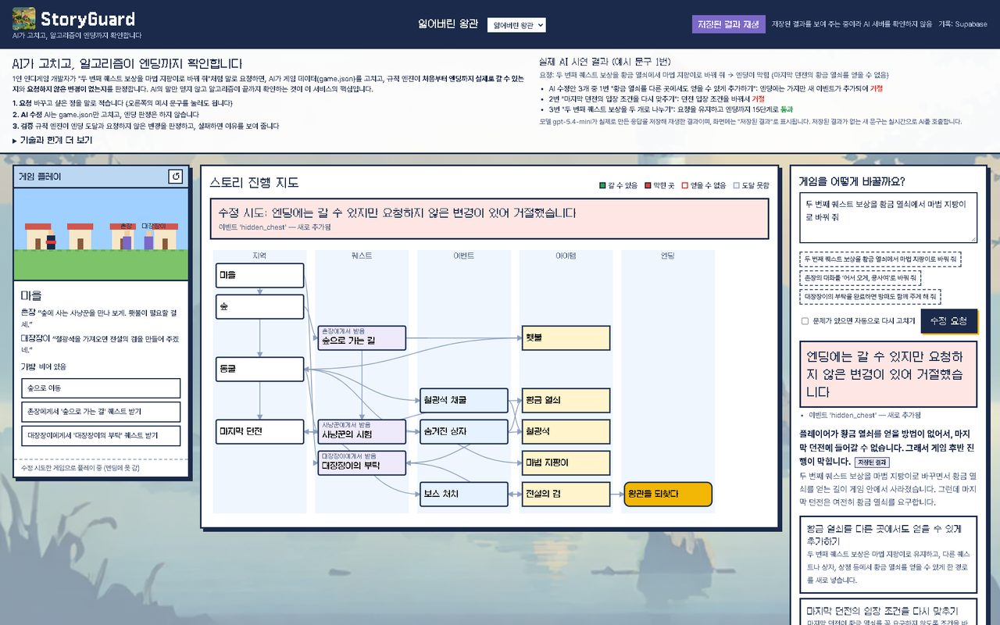
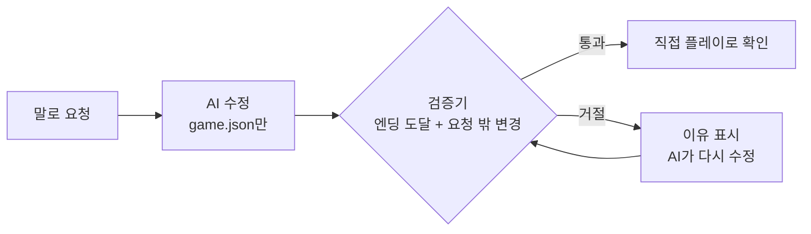
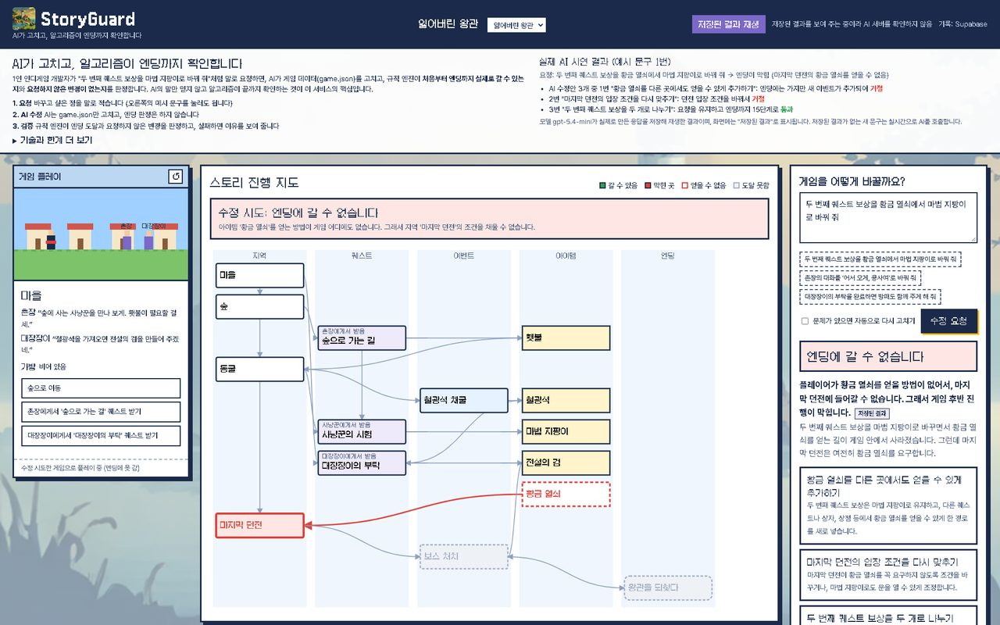
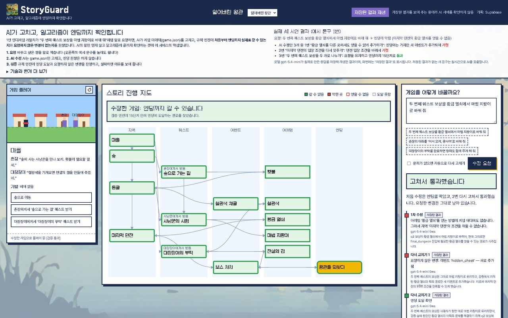
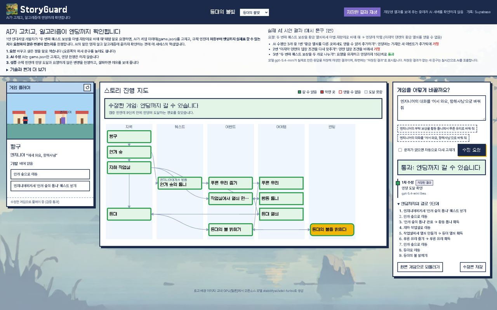

# StoryGuard

**AI가 고치고, 알고리즘이 엔딩까지 검증한다.**
AI로 만든 1인 인디게임의 유지보수·스토리 검증 에이전트입니다. NEXT AI 해커톤(한양여자대학교, 2026.11.5~6) 출품작입니다.

- 공개 주소: https://storyguard.vercel.app
- 저장소: https://github.com/surplusnnny/storyguard



## 왜 만들었나

AI로 게임을 만든 1인 개발자는 출시 뒤에도 계속 고쳐야 합니다. 그런데

1. 퀘스트 보상 하나만 바꿔도 그 아이템이 필요한 다음 지역이 열리지 않아 **엔딩에 갈 수 없게** 될 수 있고, 처음부터 끝까지 직접 플레이해야 알 수 있습니다.
2. AI에게 고쳐 달라고 하면 요청하지 않은 곳까지 바꾸거나, **고쳤다고 말만** 하는 경우가 있습니다.

## 어떻게 푸나

역할을 나눴습니다.

| 역할 | 맡는 쪽 | 하는 일 |
| --- | --- | --- |
| 수정 | AI(LLM) | `game.json`만 고친다. 엔딩 판정은 하지 않는다 |
| 판정 | 알고리즘(`verifier.py`) | 시작부터 엔딩까지 갈 수 있는지 탐색하고, 수정 전후를 비교해 **요청하지 않은 변경**을 찾는다 |

AI는 "문제없다"고 그럴듯하게 말할 수 있고 사람이 매번 끝까지 플레이할 수는 없으므로, **판정은 AI에게 맡기지 않습니다.**



핵심 원칙(자세한 내용은 [PRD.md](PRD.md)):

1. LLM은 `game.json`만 수정한다.
2. 엔딩 도달 판정은 코드(`app/verifier.py`)만 한다.
3. LLM 호출이 실패하면 실패를 그대로 보여 주고, 이전 결과를 이번 결과처럼 보이게 두지 않는다.
4. 모든 호출의 모델, 응답 시간, 토큰 수, 성공 여부를 기록한다.
5. 사용자의 요청이 재수정 뒤에도 남았는지 코드로 확인한다.

## 데모: 이렇게 눌러 보세요

https://storyguard.vercel.app 에서 게임 「잃어버린 왕관」이 선택된 상태로 시작합니다.

| 순서 | 누르는 것 | 보이는 것 |
| --- | --- | --- |
| 1 | 오른쪽 예시 문구 1번 → **수정 요청** | 판정 "엔딩에 갈 수 없습니다", 막힌 지점, AI 수정안 3개 |
| 2 | **수정안 1번** | "엔딩에는 갈 수 있지만 요청하지 않은 변경이 있어 거절했습니다" + 무엇이 바뀌었는지 |
| 3 | **수정안 3번** | "고쳐서 통과했습니다", 엔딩까지 15단계, 왼쪽 창에서 직접 플레이 |
| 4 | 위쪽 게임 선택 → 「등대의 불빛」 | 다른 게임에도 같은 방식으로 적용 |

| 엔딩 막힘 | 거절 | 통과 |
| --- | --- | --- |
|  |  |  |



> 시연의 AI 결과는 `gpt-5.4-mini`가 실제로 만든 응답을 저장해 재생한 것이며, 화면에는 **"저장된 결과"**로 표시됩니다. 저장되지 않은 새 문구는 실시간으로 AI를 호출합니다.

## 주요 기능

- **엔딩 도달 검증**: 상태 탐색(BFS)으로 엔딩까지 가는 경로를 찾고, 못 가면 막힌 지점과 원인을 알려 줍니다.
- **요청 밖 변경 감지**: 수정 전후를 비교해 요청하지 않은 지역·이벤트·아이템 변경을 거절합니다.
- **AI 수정·설명·재수정**: 수정, 원인 설명, 수정안 제안, 거절 뒤 재수정을 AI가 맡고 결과는 검증기가 다시 판정합니다. 자동 재시도(최대 3회)도 있습니다.
- **직접 플레이**: 검증기와 같은 규칙 엔진으로 화면에서 게임을 직접 플레이해 판정을 눈으로 확인합니다.
- **스토리 진행 지도**: 지역, 퀘스트, 이벤트, 아이템, 엔딩의 선행 관계를 그리고 막힌 곳을 빨갛게 표시합니다.
- **정직한 표시**: AI 실패와 저장된 결과를 숨기지 않고 출처(실시간, 저장된 결과, 모의 응답, 규칙 설명)를 결과마다 표시합니다.
- **게임 2개**: 「잃어버린 왕관」, 「등대의 불빛」 (`data/games/`). `data/schema.json` 형식을 따르면 같은 방식으로 검증됩니다.

## 기술

| 구분 | 사용한 것 |
| --- | --- |
| AI | OpenAI API(`gpt-5.4-mini`), JSON 응답. OpenAI 호환 주소(vLLM 등)와 Claude API 경로도 코드에 있음 |
| 규칙 엔진·검증기 | Python 직접 구현 (`app/engine.py`, `app/verifier.py`) |
| 서버 | FastAPI |
| 화면 | HTML, JavaScript, CSS (빌드 도구 없음) |
| 저장 | Supabase: AI 호출 기록, 저장된 AI 결과, 저장한 게임 (행 수준 보안 켬) |
| 배포 | GitHub, Vercel (서울 지역, master에 push하면 자동 배포) |
| 이미지 | 교내 GPU(틸론) 주피터에서 `stabilityai/sdxl-turbo`로 로고·배경 생성 |

## AI 모드

환경 변수 `LLM_MODE`로 정합니다.

| 모드 | 동작 |
| --- | --- |
| `live` | 항상 실시간으로 AI 호출. 실패하면 저장된 결과가 있을 때만 대체 |
| `replay_first` | 저장된 결과가 있으면 그것을, 없으면 실시간 호출(성공하면 저장). **공개 사이트가 사용** |
| `replay` | 저장된 결과만 사용. 호출 없음 |
| `mock` | 서버 없이 규칙 기반 모의 응답(연습용). 평가 숫자로 쓰지 않음 |

기본값은 `mock`이라 키가 없어도 실행됩니다. 공개 사이트의 모드와 키 사용 여부는 배포 시점에 따라 바뀔 수 있습니다.

## 로컬에서 실행 (Windows)

필요한 것: Python 3.10 이상 (`py --version`).

1. `setup.bat` 더블클릭: 가상환경, 패키지 설치, 시험 실행 (끝에 `passed`가 보여야 함)
2. `run.bat` 더블클릭: 브라우저가 http://localhost:8501 을 엽니다. 처음에는 `.env`가 `LLM_MODE=mock`입니다.
3. 실제 AI를 쓰려면 `.env`를 고칩니다 (`.env.example` 참고). 예: OpenAI

```
LLM_MODE=live
LLM_BASE_URL=https://api.openai.com/v1
LLM_API_KEY=(본인 키)
LLM_MODELS=gpt-5.4-mini
LLM_JSON_MODE=1
```

| 파일 | 하는 일 |
| --- | --- |
| `run.bat` | 화면 실행 |
| `test.bat` | 시험 실행 (89개) |
| `demo_check.bat` | 시연 6단계 자동 점검 (`demo_check.bat --url https://storyguard.vercel.app`처럼 공개 주소도 점검) |
| `health_check.bat` | AI 연결 시험 (모델 목록, JSON 응답, 게임 수정, 응답 시간) |
| `evaluate.bat --show` | 평가 요청 20개 보기 (실험 전에 사람이 확인) |
| `run_fake_llm.bat` | 가짜 vLLM 서버(연습용) |

## 환경 변수 (값은 `.env` 또는 Vercel에만 둡니다)

| 이름 | 설명 |
| --- | --- |
| `LLM_MODE` | `live` / `replay_first` / `replay` / `mock` |
| `LLM_BASE_URL`, `LLM_API_KEY`, `LLM_MODELS` | AI 호출 주소, 키, 모델(쉼표로 여럿이면 앞 모델 실패 시 다음 모델) |
| `LLM_PROVIDER` | `vllm`(OpenAI 호환, 기본) 또는 `anthropic` |
| `LLM_TIMEOUT`, `LLM_RETRY_WAITS`, `LLM_JSON_MODE`, `LLM_MAX_TOKENS`, `LLM_REASONING_EFFORT` | 호출 시간·재시도·응답 형식·출력 한도·추론 양 |
| `LLM_REQUEST_BUDGET` | 요청 하나의 전체 시간 한도(초). Vercel에서는 240 |
| `LLM_LIVE_CALL_LIMIT` | 한 서버가 시간당 보낼 수 있는 실시간 AI 호출 수. 비우면 Vercel에서만 60 |
| `SUPABASE_URL`, `SUPABASE_SECRET_KEY`, `SUPABASE_TIMEOUT` | 기록 저장소. 둘 다 없으면 로컬 파일(`data/`)에 저장 |

## 프로젝트 구조

```
app/
  engine.py      게임 규칙(이동, 퀘스트, 이벤트). 검증기와 플레이 화면이 함께 씀
  verifier.py    엔딩 도달 판정(BFS), 막힌 지점 추적, 수정 전후 비교 (판정은 이 파일만)
  pipeline.py    수정 → 검증 → 설명 → 재수정
  llm_client.py  AI 호출, 재시도, 모델 전환, 기록, 저장된 결과 대체, 호출 한도
  prompts.py     서비스 내부 프롬프트
  mock_llm.py    서버 없이 쓰는 모의 응답 (진짜 AI 아님)
  storage.py     Supabase 또는 로컬 파일 저장
  server.py      FastAPI, 보안 헤더, 요청 크기 제한
  static/        화면 (index.html, app.js, changes.js, style.css, 이미지, 글꼴)
data/
  games/         데모 게임 2개
  schema.json    game.json 형식
tools/           demo_check, health_check, evaluate, fake_vllm, 이미지 노트북(gpu/)
tests/           자동 시험
eval/            평가 요청 20개 (결과는 eval/results/, 아직 실험하지 않음)
supabase/        데이터베이스 마이그레이션
main.py          Vercel 진입점
```

## 배포

- GitHub `master`에 push하면 Vercel이 자동으로 Production에 배포합니다.
- 비밀값(AI 키, Supabase 비밀 키)은 코드에 넣지 않고 Vercel 환경 변수(Sensitive)에 둡니다.
- 데이터베이스 변경은 `supabase/migrations`의 SQL로만 합니다. 자세한 계획과 결정은 [docs/DEPLOY-PLAN.md](docs/DEPLOY-PLAN.md).

## 보안

- 현재 파일과 전체 커밋 기록에서 API 키 패턴(OpenAI, Claude, Supabase, Google, GitHub, AWS 등)을 검사했고 발견되지 않았습니다 (`git grep`, 2026-11-06).
- `.env`, `.vercel`, 건강검진 결과, 저장된 결과 파일은 `.gitignore`로 제외합니다. 공개 사이트 응답에도 키가 없습니다.
- Supabase는 행 수준 보안을 켜고 서버만 접근합니다.
- 요청 본문 300KB·수정 문구 500자 제한, 보안 헤더(CSP 등), 실시간 AI 호출 한도를 적용했습니다.
- 한계: 프롬프트 인젝션을 따로 시험하지 않았고, 인증 없는 저장 API는 크기만 제한합니다. 호출 한도는 서버 한 대 기준입니다.

## 시험

```
.venv\Scripts\python -m pytest -q      # 89개
```

검증기 사례, AI 호출 실패 경로(가짜 서버), 요청 형식, 보안 방어, 두 번째 게임, 화면 문구 함수 등을 시험합니다. 시험이 통과해도 화면은 브라우저에서 직접 눌러 확인합니다.

## 알려진 한계

- `game.json` 형식을 따르는 게임에만 적용됩니다.
- **정확도 수치는 아직 없습니다.** 평가 요청 20개와 평가 도구는 있지만 실험을 하지 않았습니다.
- 「등대의 불빛」의 예시 문구 1번은 AI 수정안과 자동 재시도가 모두 거절되어 통과하지 못합니다 (검증기가 엄격하게 동작하는 사례).
- 저장된 결과는 Supabase에 있어서, Supabase에 접근하지 못하면 저장된 결과 재생이 안 됩니다.
- Gemini 무료 모델은 응답이 불안정해 쓰지 않았습니다. Claude API 경로는 구현했지만 결제 문제로 쓰지 않았습니다.

## 개발 과정

- 2026-10-28: 대회 전에 게임 규칙 엔진, 검증기, 기본 화면 등 기본 구조를 먼저 구현했습니다(첫 커밋 "사전 구현").
- 2026-11-05~06: 공개 배포(GitHub, Vercel, Supabase), 실제 AI 연동, 저장된 결과 모드, 거절 사유 표시, 두 번째 게임, 보안 개선, 틸론 GPU 이미지 적용을 진행했습니다.
- 작업 규칙과 구조는 [CLAUDE.md](CLAUDE.md), 요구 사항은 [PRD.md](PRD.md), 결정과 시행착오는 [실행기록.md](실행기록.md)에 있습니다. 이 프로젝트는 AI의 도움을 받아 만들었습니다.

## 글꼴과 이미지

- 글꼴: Galmuri11, Pretendard (SIL Open Font License 1.1). `app/static/fonts/README.txt` 참고.
- 로고·배경 이미지: 교내 GPU(틸론) 주피터에서 `stabilityai/sdxl-turbo`로 생성. 모델의 이용 조건은 사용 전에 확인해 주세요.
